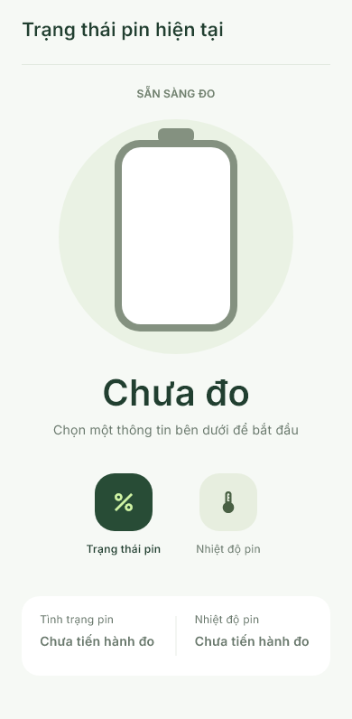
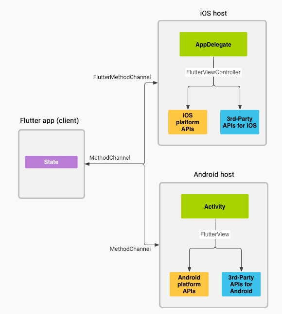
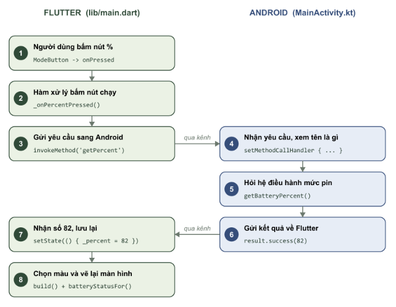

# Ứng dụng Trạng thái pin

Bài tập E-learning môn Lập trình thiết bị di động.

---
## 1. Giao diện, logic ứng dụng

Ứng dụng chỉ có một màn hình. Trên màn hình có hình một viên pin và hai nút bấm:

* **Nút %**: lấy phần trăm pin của điện thoại.
* **Nút nhiệt kế**: lấy nhiệt độ của pin.



Sau khi bấm, màn hình hiện con số vừa lấy được và tự đổi màu: **xanh** là bình thường, **vàng** là pin yếu, **đỏ** là pin quá nóng.

---

## 2. Vấn đề giải quyết

Flutter chỉ lo phần giao diện. Tự nó không đọc được thông tin pin của điện thoại. Người biết thông tin đó là hệ điều hành Android.



Vì vậy ứng dụng chia làm hai phía, và cần một cách để hai phía nói chuyện với nhau:

| Phía | Viết bằng | Nhiệm vụ |
| :--- | :--- | :--- |
| **Flutter** | Dart | Vẽ màn hình, nhận thao tác bấm nút, hiển thị kết quả. |
| **Android** | Kotlin | Hỏi hệ điều hành mức pin và nhiệt độ pin. |

Cách để hai phía nói chuyện gọi là **Platform Channel**. Trong code, nó là lớp `MethodChannel`.

> **Hình dung đơn giản:** `MethodChannel` giống một đường dây điện thoại có tên riêng. Flutter nhấc máy và nói *"cho tôi phần trăm pin"*. Android nghe, đi lấy số liệu, rồi trả lời qua chính đường dây đó. Flutter đứng chờ đến khi có câu trả lời.

---

## 3. Các file trong dự án

| File | Chứa gì |
| :--- | :--- |
| `lib/main.dart` | File chính. Chứa kênh, hai hàm gọi sang Android, quy tắc đổi màu và toàn bộ màn hình. |
| `android/.../MainActivity.kt` | Code Android. Nhận yêu cầu từ Flutter và trả về số liệu pin. |
| `lib/theme/battery_palette.dart` | Bốn bộ màu (xám, xanh, vàng, đỏ). Mỗi bộ gồm màu nền, màu pin, màu nút, màu chữ. |
| `lib/widgets/battery_icon.dart` | Widget vẽ hình viên pin. |
| `lib/widgets/mode_button.dart` | Widget của một nút bấm (icon + nhãn). |

Để hiểu luồng dữ liệu, bạn chỉ cần đọc hai file đầu tiên. Ba file còn lại chỉ lo phần hình ảnh.

---

## 4. Đường đi của dữ liệu khi bấm nút %

Sơ đồ dưới đây cho thấy 8 bước, theo đúng thứ tự. Ví dụ pin đang ở mức $82\%$.



### Chi tiết từng bước

| Bước  | Ở đâu             | Chuyện gì xảy ra                                                                    |
| :---: | :---------------- | :---------------------------------------------------------------------------------- |
| **1** | `main.dart`       | Người dùng bấm nút %. Nút gọi hàm đã gắn ở `onPressed`.                             |
| **2** | `main.dart`       | Hàm `_onPercentPressed()` chạy và gọi `getBatteryPercent()`.                        |
| **3** | `main.dart`       | `invokeMethod('getPercent')` gửi yêu cầu tên `"getPercent"` qua kênh, rồi đứng chờ. |
| **4** | `MainActivity.kt` | Android nhận yêu cầu, thấy tên là `"getPercent"`.                                   |
| **5** | `MainActivity.kt` | Hàm `getBatteryPercent()` hỏi hệ điều hành và nhận về `82`.                         |
| **6** | `MainActivity.kt` | `result.success(82)` gửi số `82` về lại Flutter.                                    |
| **7** | `main.dart`       | Flutter hết chờ, nhận `82` và lưu vào biến `_percent` bằng `setState`.              |
| **8** | `main.dart`       | `build()` chạy lại: chọn bộ màu xanh và vẽ lại màn hình với số $82\%$.              |

---

## 5. Đi qua từng đoạn code

Phần này lấy đúng các đoạn code cốt lõi trong dự án và giải thích theo thứ tự 8 bước ở trên.

### 5.1. Tạo kênh ở cả hai phía

**`lib/main.dart`**
```dart
const batteryChannel = MethodChannel('cosXbatteryChannel');
```

**`android/.../MainActivity.kt`**
```kotlin
private val batteryChannel = "cosXbatteryChannel"
```

Hai dòng này đặt tên cho "đường dây". Tên ở hai phía phải giống nhau từng chữ. Nếu viết lệch một ký tự, Flutter gọi nhưng Android không nghe thấy.

### 5.2. Bấm nút thì gọi hàm nào? (bước 1)

**`lib/main.dart`** *(trong hàm `build()`)*
```dart
ModeButton(
  icon: Symbols.percent,
  label: 'Trạng thái pin',
  selected: _mode == BatteryInfoMode.level,
  palette: palette,
  onPressed: _onPercentPressed,
),
```

Dòng `onPressed: _onPercentPressed` nghĩa là: khi nút này được bấm, hãy chạy hàm `_onPercentPressed`. Nút nhiệt độ viết y hệt, chỉ khác là gắn hàm `_onTemperaturePressed`.

### 5.3. Hàm xử lý khi bấm nút (bước 2 và bước 7)

**`lib/main.dart`**
```dart
Future<void> _onPercentPressed() async {
  final percent = await getBatteryPercent();
  if (!mounted) return;
  setState(() {
    _mode = BatteryInfoMode.level;
    _percent = percent;
  });
}
```

* **Dòng 2:** gọi `getBatteryPercent()` để lấy phần trăm pin. Chữ `await` nghĩa là *"chờ ở đây đến khi có kết quả rồi mới chạy tiếp"*. Trong lúc chờ, màn hình không bị đứng.
* **Dòng 3:** `mounted` cho biết màn hình còn đang hiển thị hay không. Nếu người dùng đã thoát trong lúc chờ thì dừng lại, không làm gì nữa.
* **Dòng 4-7:** `setState` làm hai việc: lưu giá trị mới vào biến, và báo cho Flutter biết *"dữ liệu đã đổi, hãy vẽ lại màn hình"*. Ở đây lưu hai thứ: nút nào đang được chọn (`_mode`) và phần trăm pin (`_percent`).

### 5.4. Hàm gửi yêu cầu sang Android (bước 3)

**`lib/main.dart`**
```dart
Future<int?> getBatteryPercent() async {
  try {
    final int? percent = await batteryChannel.invokeMethod<int>('getPercent');
    return percent;
  } catch (e) {
    return null;
  }
}
```

* `invokeMethod<int>('getPercent')` là câu Flutter "nói vào điện thoại". Chữ `'getPercent'` là tên yêu cầu. `<int>` cho biết ta mong nhận về một số nguyên.
* `Future<int?>` nghĩa là: hàm này không trả kết quả ngay, mà trả sau một lúc. Kết quả là một số nguyên, hoặc `null` (không có gì).
* `try / catch`: nếu Android báo lỗi thì chạy vào phần `catch` và trả về `null`. Nhờ vậy ứng dụng không bị văng, màn hình chỉ hiện `"Chưa đo"`.

### 5.5. Android nhận yêu cầu (bước 4 và bước 6)

**`android/.../MainActivity.kt`**
```kotlin
override fun configureFlutterEngine(flutterEngine: FlutterEngine) {
    super.configureFlutterEngine(flutterEngine)
    MethodChannel(flutterEngine.dartExecutor.binaryMessenger, batteryChannel)
        .setMethodCallHandler { call, result ->
            when (call.method) {
                "getPercent" -> result.success(getBatteryPercent())
                "getTemperature" -> {
                    val temperature = getBatteryTemperature()
                    if (temperature != null) {
                        result.success(temperature)
                    } else {
                        result.error("UNAVAILABLE", "Không đọc được nhiệt độ pin", null)
                    }
                }
                else -> result.notImplemented()
            }
        }
}
```

* `configureFlutterEngine` là hàm Android tự gọi một lần khi ứng dụng khởi động. Ta đặt kênh ở đây để nó sẵn sàng trước khi người dùng bấm nút.
* `setMethodCallHandler` nghĩa là *"mỗi khi Flutter gọi tới, hãy chạy đoạn code này"*. Đoạn code nhận hai thứ: `call` (Flutter hỏi gì) và `result` (dùng để trả lời).
* `when (call.method)` xem tên yêu cầu là gì rồi chọn việc cần làm, giống `switch` bên Dart.
* Có ba cách trả lời: `result.success(...)` là trả về kết quả; `result.error(...)` là báo có lỗi; `result.notImplemented()` là báo *"tôi không biết yêu cầu này"*.

### 5.6. Android lấy số liệu pin (bước 5)

**`android/.../MainActivity.kt`**
```kotlin
private fun getBatteryPercent(): Int {
    val batteryManager = getSystemService(Context.BATTERY_SERVICE) as BatteryManager
    return batteryManager.getIntProperty(BatteryManager.BATTERY_PROPERTY_CAPACITY)
}
```

`BatteryManager` là công cụ có sẵn của Android để hỏi về pin. Dòng đầu lấy công cụ đó ra, dòng sau hỏi nó phần trăm pin hiện tại. Kết quả là một số từ $0$ đến $100$.

**`android/.../MainActivity.kt`**
```kotlin
private fun getBatteryTemperature(): Double? {
    val batteryInfo = registerReceiver(null, IntentFilter(Intent.ACTION_BATTERY_CHANGED))
    val tenths = batteryInfo?.getIntExtra(BatteryManager.EXTRA_TEMPERATURE, -1) ?: -1
    return if (tenths == -1) null else tenths / 10.0
}
```

* Dòng đầu lấy bản thông tin pin mới nhất mà Android đang giữ.
* Dòng hai đọc nhiệt độ trong bản thông tin đó. Nếu không đọc được thì dùng số `-1` để đánh dấu.
* Android lưu nhiệt độ theo đơn vị một phần mười độ C. Ví dụ $325$ nghĩa là $32.5^\circ\text{C}$. Vì vậy dòng ba phải chia cho $10$ trước khi trả về.

### 5.7. Quy tắc đổi màu (bước 8)

**`lib/main.dart`**
```dart
const int lowBatteryPercent = 20;
const double highBatteryTemperature = 45;

BatteryStatus batteryStatusFor({
  required BatteryInfoMode? mode,
  required int? percent,
  required double? temperature,
}) {
  switch (mode) {
    case null:
      return BatteryStatus.idle;
    case BatteryInfoMode.level:
      if (percent == null) return BatteryStatus.idle;
      return percent <= lowBatteryPercent
          ? BatteryStatus.bad
          : BatteryStatus.normal;
    case BatteryInfoMode.temperature:
      if (temperature == null) return BatteryStatus.idle;
      return temperature >= highBatteryTemperature
          ? BatteryStatus.overheat
          : BatteryStatus.normal;
  }
}
```

Hàm này nhận vào ba thứ đang lưu (nút đang chọn, phần trăm, nhiệt độ) và trả về một trong bốn trạng thái. Mỗi trạng thái ứng với một bộ màu:

| Nút đang chọn | Dữ liệu | Trạng thái | Màu |
| :--- | :--- | :--- | :--- |
| Chưa bấm nút nào | — | `idle` | Xám (chưa đo) |
| Bất kỳ | `null` (không lấy được) | `idle` | Xám (chưa đo) |
| Nút % | Trên $20$ | `normal` | Xanh |
| Nút % | Từ $20$ trở xuống | `bad` | Vàng |
| Nút nhiệt độ | Dưới $45^\circ\text{C}$ | `normal` | Xanh |
| Nút nhiệt độ | Từ $45^\circ\text{C}$ trở lên | `overheat` | Đỏ |

Muốn đổi ngưỡng, chỉ cần sửa hai con số `20` và `45` ở hai dòng đầu.

### 5.8. Dùng màu để vẽ màn hình (bước 8)

**`lib/main.dart`** *(đầu hàm `build()`)*
```dart
final status = batteryStatusFor(
  mode: _mode,
  percent: _percent,
  temperature: _temperature,
);
final palette = BatteryPalette.of(status);
```

Mỗi lần `setState` được gọi, Flutter chạy lại hàm `build()`. Hai câu lệnh trên là việc đầu tiên nó làm:
* Hỏi `batteryStatusFor` xem đang ở trạng thái nào.
* Lấy bộ màu của trạng thái đó bằng `BatteryPalette.of(status)` và cất vào biến `palette`.

Sau đó mọi phần trên màn hình đều lấy màu từ `palette`:

**`lib/main.dart`** *(trong hàm `build()`)*
```dart
Scaffold(
  backgroundColor: palette.background,
  ...
)

BatteryIcon(status: status, level: fillLevel, palette: palette)
ModeButton(..., palette: palette, ...)
```

Đây là lý do nền và nút đổi màu theo viên pin: cả ba đều dùng chung một biến `palette`. Khi trạng thái đổi, `palette` đổi, và tất cả đổi màu cùng lúc.

---

## 6. Bấm nút nhiệt độ thì khác gì?

Đường đi hoàn toàn giống 8 bước ở mục 4. Chỉ khác tên:

| Tiêu chí | Nút % | Nút nhiệt độ |
| :--- | :--- | :--- |
| **Hàm xử lý bấm nút** | `_onPercentPressed` | `_onTemperaturePressed` |
| **Hàm gọi sang Android** | `getBatteryPercent` | `getBatteryTemperature` |
| **Tên yêu cầu gửi đi** | `'getPercent'` | `'getTemperature'` |
| **Kiểu dữ liệu nhận về** | Số nguyên (`int`) | Số thập phân (`double`) |
| **Biến lưu kết quả** | `_percent` | `_temperature` |

---

## 7. Nếu có lỗi thì sao?

* Android không đọc được nhiệt độ: nó gọi `result.error(...)`.
* Bên Flutter, lỗi đó rơi vào phần `catch` và hàm trả về `null`.
* `batteryStatusFor` thấy `null` nên trả về trạng thái `idle`. Màn hình hiện `"Chưa đo"` với màu xám.

Ứng dụng không bị văng trong bất kỳ trường hợp nào ở trên.

---

## 8. Vài từ cần biết

| Từ | Nghĩa đơn giản |
| :--- | :--- |
| `MethodChannel` | Đường dây có tên riêng để Flutter và Android nói chuyện với nhau. |
| `invokeMethod` | Flutter gửi một yêu cầu qua kênh và chờ câu trả lời. |
| `setMethodCallHandler` | Android đăng ký đoạn code sẽ chạy mỗi khi Flutter gọi tới. |
| `Future` | Một kết quả chưa có ngay, sẽ có sau một lúc. |
| `async` / `await` | `await` là *"chờ kết quả rồi chạy tiếp"*. Hàm nào dùng `await` thì phải ghi `async`. |
| `null` | Không có giá trị. Trong ứng dụng này nghĩa là *"chưa đo được"*. |
| `setState` | Lưu dữ liệu mới và báo Flutter vẽ lại màn hình. |
| `build()` | Hàm vẽ màn hình. Flutter gọi lại mỗi khi có `setState`. |

---

> **Tóm tắt luồng hoạt động của ứng dụng:** bấm nút $\rightarrow$ Flutter gửi tên yêu cầu qua `MethodChannel` $\rightarrow$ Android lấy số liệu pin và gửi về $\rightarrow$ Flutter lưu lại bằng `setState` $\rightarrow$ `build()` chọn bộ màu phù hợp và vẽ lại màn hình.

---
## 10. Lưu ý nhỏ: Project này không dùng backgroundIsolated thread
~~Lý do không cần:~~
- ~~**Việc lấy pin rất nhẹ.** Hỏi `BatteryManager` phần trăm pin hay đọc nhiệt độ chỉ mất chưa tới một phần nghìn giây. Isolate nền chỉ đáng dùng cho việc tính toán nặng kéo dài (xử lý ảnh, đọc file lớn, phân tích JSON rất to), khi đó nếu để trên isolate chính thì màn hình sẽ giật. Và ứng dụng hiện tại chỉ gọi hàm lấy pin khi người dùng nhấn nút chứ không tạo phòng lặp để người dùng cập nhật trạng thái pin liên tục. Nếu về sau có dùng loop để liên tục cập nhật trạng thái thì lúc đó mới cần dùng đến background isolated~~
- ~~**Màn hình không bị đứng nhờ `async/await`, không phải nhờ isolate.** Khi gọi `await batteryChannel.invokeMethod(...)`, isolate chính gửi yêu cầu đi rồi quay lại vẽ màn hình tiếp; lúc Android trả lời thì nó mới chạy tiếp phần sau `await`. Đây là chờ mà không chặn, vẫn chỉ trên một isolate.~~
---
***Nguồn tài liệu tham khảo:***
https://youtu.be/j0cy_Z6IG_c?si=kueZVIHhYuifnriY
[Write platform-specific code with platform channels](https://docs.flutter.dev/platform-integration/platform-channels)
